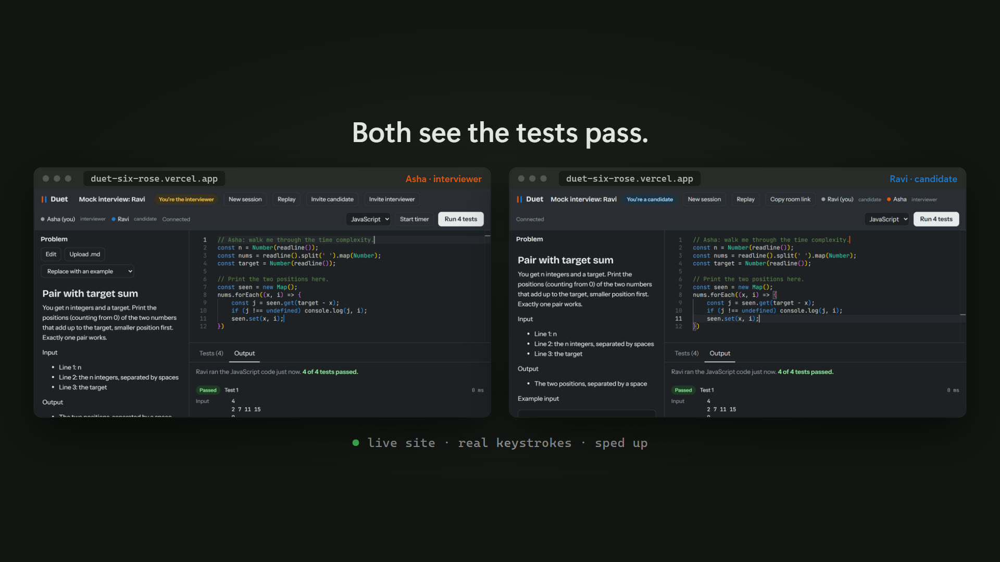
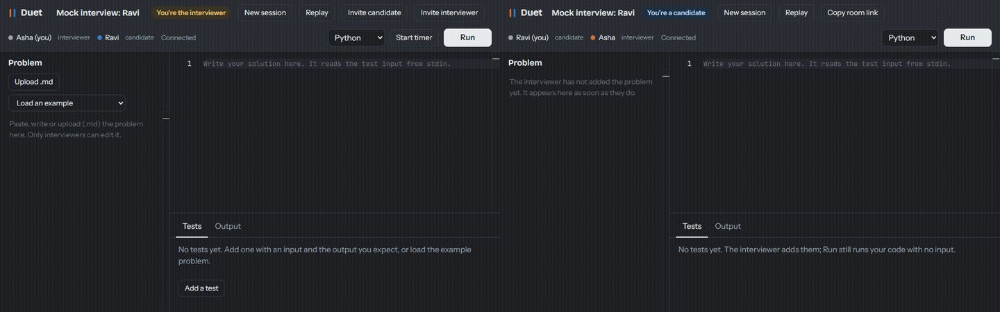

# Duet

A live coding-interview room. 2–4 people open a room link and edit one file together in the browser. Code runs against test cases in a sandbox (Week 2), and sessions can be replayed keystroke by keystroke (Week 3).

The sync engine is my own operational transformation (OT) with a central server. No Yjs, ShareDB or Automerge. See [docs/DESIGN.md](docs/DESIGN.md) for every decision and [docs/METRICS.md](docs/METRICS.md) for every number, with how each was measured.

**Live:** https://duet-six-rose.vercel.app (create a room, open the link on a second device). The server runs on Render's free tier, so the first visit after a quiet spell can take about a minute while it wakes.

**Launch video** (21 s, with sound): click the poster to play [docs/brag.mp4](docs/brag.mp4).

[](docs/brag.mp4)



*Two real browser windows, Asha (left) and Ravi (right), typing in the same room on the live site at the same time. Each sees the other's cursor in the other's colour, and both end up with the same text as the server. The GIF is recorded by `npm run demo` (`packages/bench/src/record-demo.ts`), which also checks that final match.*

**Roles:** the person who creates a room is the interviewer. They write the problem (or upload it as `.md`), set the test cases and run the timer. Candidates join from the plain link, read the problem, write code and run it. The server enforces the roles, and "Invite interviewer" adds a co-interviewer.

**Saved rooms:** with a database connected (Supabase Postgres), rooms survive restarts, and the front page lists "Your rooms".

**What you can do in a room:**
- 2–4 people edit the code and the problem statement together, each seeing the others' cursors.
- Add test cases (input and expected output).
- Run JavaScript or Python against them in the browser. Everyone sees the result.
- Keep time with a shared interview timer.
- Start from an example problem with one click.

**Reconnect:** if the connection drops, keep typing. On the way back the page gets exactly what it missed, and every edit lands once: none lost, none doubled ([DESIGN §15](docs/DESIGN.md)).

**Status:** the sync core, the interview room, saved rooms, roles and reconnect are done. Next are the replay UI and the server-side Docker runner (C++ and stronger isolation). The plan is in [PLAN.md](PLAN.md).

## Layout

| Path | What it is |
|---|---|
| `packages/ot` | Operations (retain/insert/delete) with `apply`, `compose`, `transform`; the client state machine; the server document; the wire protocol types; and the randomized convergence tests |
| `packages/server` | Node + `ws` WebSocket server: rooms of up to 4, presence, and the naive baseline mode |
| `packages/web` | React + Monaco front end and the editor ↔ OT binding (`src/session.ts`) |
| `packages/bench` | Bot load test plus the OT-vs-naive comparison (`src/bots.ts`), the browser exit test (`src/e2e.ts`), the reconnect test (`src/reconnect.ts`) and the crash-recovery test (`src/recovery.ts`) |
| `bench/results` | Raw JSON from every benchmark run quoted in `METRICS.md` |

## Run it

Needs Node 22+.

```bash
npm install
npm run server                     # WebSocket server on :4000 (PORT=... to change)
npm run web                        # Vite dev server on :5173, proxies /ws and /api to :4000
```

Open `http://localhost:5173`, create a room, and open the link in a second tab.

If the ports are taken, run `PORT=4100 npm run server` and `DUET_SERVER=http://localhost:4100 npm run web -- --port 5180`.

For the naive baseline, run `DUET_SYNC=naive npm run server`. Every change then sends the whole file and the server relays it, as Code-Sync does. Type in two tabs at once and watch edits disappear.

## Deploy

The front end deploys to Vercel (`vercel.json`) and the WebSocket server to Render as a Docker web service (`render.yaml`, `Dockerfile`). Step-by-step instructions and free-tier caveats are in [docs/DEPLOY.md](docs/DEPLOY.md).

## Tests and measurements

```bash
npm test                           # unit + randomized convergence property tests
OT_SCALE=10 npm test               # 10x soak run of the property tests
npm run e2e                        # exit test: browser tabs type concurrently, must end identical (needs server + web running; uses installed Edge)
npm run reconnect                  # browser test: lose an ack, lose an op, cut the network; every edit must land once
npm run bench                      # bot load test (see the header of packages/bench/src/bots.ts for settings)
npm run demo                       # record docs/demo.gif from the live site (uses installed Edge and ffmpeg)
```

## References and credits

I studied these projects for structure and ideas. **No code was copied from any of them, and none of them was forked.**

- [ot.js](https://github.com/Operational-Transformation/ot.js) by Tim Baumann (MIT). The operation encoding (positive integer = retain, string = insert, negative integer = delete) and the client model (one op in flight plus a buffer) follow its design. The code in `packages/ot` was written from the algorithm.
- [avelin](https://github.com/avelinapp/avelin) and [corust](https://github.com/brylee10/corust): how a collaborative editor splits into web, API and sync services.
- [Code-Sync](https://github.com/sahilatahar/Code-Sync) and [caucus](https://github.com/Rishabh-malhotraa/caucus): the common version, which syncs with whole-file rebroadcast (Code-Sync) or Yjs (caucus). Duet's naive baseline mode reproduces Code-Sync's `FILE_UPDATED` behaviour so the two can be measured against each other.
- [piston](https://github.com/engineer-man/piston), [kira](https://github.com/FlorianWoelki/kira), [pesto](https://github.com/teknologi-umum/pesto) and [isolate](https://github.com/ioi/isolate): runner and sandbox designs (Week 2).
